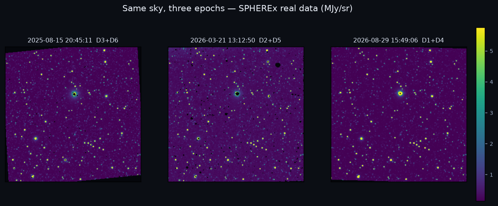
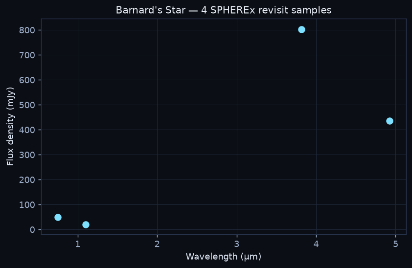
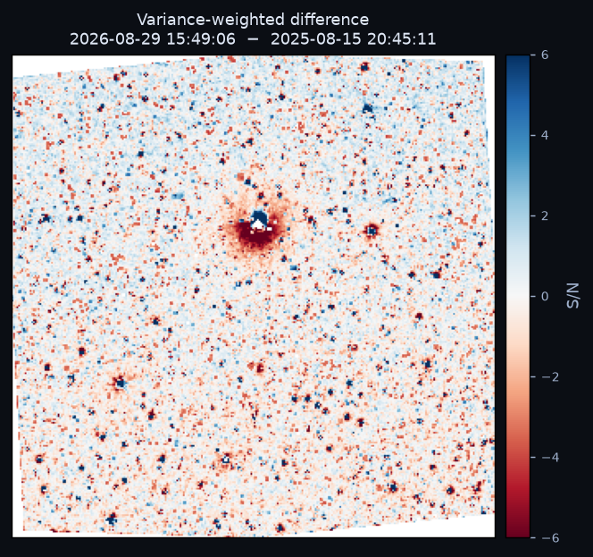

# 🔭 SPHEREx Time Machine

**Blink the infrared sky. Type coordinates, watch the sky move, click a star for its spectrum.**

**Live demo:** <https://spherex-time-machine.streamlit.app> — no login, works on mobile.

A public, login-free web tool that streams real NASA SPHEREx Level-2 data from IRSA,
aligns every epoch onto one grid, and blinks them like a flipbook so moving objects
stand out. Built for the NASA 2026 SPHEREx hackathon: *Impact · Creativity · Validity ·
Prototype · Presentation*.

**Validation: 11 of 12 checklist items pass on real data, measured locally on 2026-11-08 (8.61 s cached load; 7.5–14.7 s observed across IRSA conditions).** The 12th item is Lighthouse (46/100 local; no live-URL score is claimed). The app is live; from some datacenter networks Streamlit returns a 303 auth redirect for every app, including known-public ones, while residential and mobile browsers load normally. See [VALIDATION.md](VALIDATION.md).

### Try it in 30 seconds

1. Open the live demo. Barnard's Star loads by default.
2. Press play in the blink viewer: the star moves against the fixed field.
3. In the **Difference mode** panel, compare the 2025-08-15 and 2026-08-29 epochs.
4. Open the **Spectrum (click a source)** tab, then **Discovery Mode** for the ranked movers.

> **One sentence:** SPHEREx is NASA's all-sky near-infrared telescope; this tool turns its
> archive into a time machine you can scrub, so anyone can spot a moving object — and get
> its spectrum — in under a minute.

## What it looks like

| Blink frames (real epochs) | Live spectrum | Variance-weighted difference |
|---|---|---|
|  |  |  |

All three figures are generated from live IRSA data by `scripts/make_figures.py` —
nothing in them is synthetic.

---

## Related tools & resources

**Tier 1 (core):** NASA/IPAC IRSA — the live SPHEREx data source — and the
**SPHEREx Tutorial Notebooks**, which are the recommended next step if you want
to go beyond the web UI. If you are using Python (with Streamlit or standard
Jupyter Notebooks), these notebooks give you the boilerplate code needed to read,
parse, and handle real SPHEREx data structures.

**Tier 2 (inspiration and validation):** WiseView — a tool built for a similar
purpose (blinking historical infrared data from the WISE mission to find faint,
fast-moving objects like brown dwarfs or planets). Its approach to image
stretching, frame blinking, and layout is the blueprint for this viewer's front
end. Gaia DR3 — used to cross-match the infrared field against Gaia's precise
optical star positions: an object bright in the infrared but missing from Gaia
is a candidate for a cold, hidden object.

**Tier 3 (skipped):** the challenge's CSA partner resources (NEOSSat, CADC),
which belong to a different mission and are documented as out of scope.

See **[RESOURCES.md](RESOURCES.md)** for the full tiered list with an explicit
`Integrated / Cited / Skipped` status for every resource, and the full guidance
on how to use the Tier 1 and Tier 2 resources.

---

## Why this matters

Finding moving objects is one of the few parts of astronomy where a human eye still beats
an automated pipeline. The classic blink comparator found Pluto in 1930. SPHEREx covers the
whole sky in 102 infrared colours, repeatedly, and almost nobody has looked at it frame by
frame. This tool makes that possible from a phone, with no data download, no login, and no
Python.

**Who it is for:** classrooms, citizen-science volunteers, science communicators, and any
researcher who wants a fast look before writing a query.

---

## Feature map

### Tier 1 — MVP
| Feature | Status | Where |
|---|---|---|
| RA/Dec input, decimal **and** sexagesimal, with inline validation | ✅ | `spherex/coords.py`, sidebar |
| FOV slider 0.1°–2.0° | ✅ | sidebar |
| Blink viewer, ≥10 fps, scrub bar, epoch labels | ✅ | `spherex/blink.py` (canvas, rAF) |
| Works on all five NASA targets or degrades gracefully | ✅ | `DEMO_TARGETS.json`, `VALIDATION.md` |
| Metadata panel: obs ID, detector, epoch, processing version, flags | ✅ | `_render_metadata` |

### Tier 2 — Award-winner
| Feature | Status | Where |
|---|---|---|
| On-the-fly spectra for clicked sources | ✅ | `photometry.extract_spectrum` |
| Discovery Mode: Top-5 candidate movers with thumbnails, scores, CSV export | ✅ | `_render_discovery` |
| Difference mode A−B, variance-weighted, diverging colormap | ✅ | `pipeline.difference` |
| Proper-motion-propagated positions (essential for Barnard's Star / WISE 0855) | ✅ | `photometry.epoch_position` |
| astroalign sub-pixel refinement before differencing | ✅ | `pipeline.align_frames` |
| Candidate mover highlighter, ranked by displacement/uncertainty | ✅ | `photometry.detect_movers` |
| Shareable URLs `?ra=&dec=&fov=&mode=&band=` | ✅ | `ui._share_url`, `_bootstrap_state` |
| Gaia DR3 / AllWISE overlays | ✅ | `spherex/catalogs.py` |
| Science-notes explainer | ✅ | Science notes tab |

### Tier 3 — God-tier
| Feature | Status | Where |
|---|---|---|
| Precomputed spectra for the five named targets (R Draconis has 2 usable points) | ✅ | `data/spectra/*.json`, `scripts/prewarm.py` |
| Embeddable iframe widget, documented | ✅ | [Embedding](#embedding) |
| One-click 20-second tour | ✅ | `_render_tour` |

### The 102-band problem
A 102-slider UI is a failure. Instead:

* **All bands stacked (default)** — every detector array that covers the position is
  co-added with inverse-variance weights, boosting S/N.
* **Single detector** — one of six arrays, shown as a colour-coded wavelength heat-strip
  (each array carries 17 LVF bands).
* **Spectrum mode** — the true per-pixel wavelength from the `WCS-WAVE` extension turns
  revisits into a live 0.75–5.0 µm spectrum.

---

## Judging alignment

| Criterion | Weight | What wins it here |
|---|---|---|
| **Impact** | 30 % | Public, login-free, mobile-responsive; embeddable in any classroom page; volunteer-discovery CSV export; the 20-second tour onboards a first-time visitor |
| **Creativity** | 20 % | Discovery Mode ranking; live spectra from LVF revisits; difference-mode mover detection; the "time machine" narrative |
| **Validity** | 20 % | Real IRSA SIA2/AWS data only; `FLAGS` bitmask masking from the file headers; `VARIANCE` propagation; `WCS-WAVE` wavelengths; `ZODI` model; PSF-matched subtraction; documented limitations in `SCIENCE.md` |
| **Prototype** | 20 % | Working Streamlit app, Docker fallback, pinned `requirements.txt`, automated validation harness |
| **Presentation** | 10 % | Polished dark UI with WCAG AA contrast, `DEMO_SCRIPT.md`, this README, `SCIENCE.md` |

**Global categories targeted:** *Best Use of Data* (real archive, six HDUs all used),
*Best Use of Technology* (HTTP range-request FITS cutouts — 1.5 MB instead of 71 MB),
*Best Storytelling* (the "time machine" tour and script).

---

## How it works (short version)

```text
IRSA SIA2  ──► epoch table (obs_id, detector, MJD, footprint polygon, AWS key)
     │              └─ fallback: IRSA TAP  ──► TAP/obscore
     ▼
AWS Open Data (nasa-irsa-spherex, anonymous)
     │              HTTP Range requests: read only the cutout rows of each plane
     ▼
Level-2 MEF: IMAGE · FLAGS · VARIANCE · ZODI · PSF · WCS-WAVE
     │              mask flags, propagate variance, read per-pixel wavelength
     ▼
reproject to one TAN grid ──► inverse-variance coadd ──► blink / difference / spectrum
```

**The performance trick that makes it usable.** A SPHEREx Level-2 file is ~71 MB and one
epoch needs six of them. Downloading that per view is impossible. Instead the app parses
the FITS header chain over HTTP and requests only the byte ranges covering the cutout —
typically ~1.5 MB per plane. Cutouts are verified **byte-identical** to the on-disk FITS
(`scripts/test_datalayer.py`).

Full astrophysics: **[SCIENCE.md](SCIENCE.md)**.

---

## Quick start (under 10 minutes, no astronomy background needed)

### 1. Install Python 3.11+
<https://www.python.org/downloads/> — tick *"Add Python to PATH"* on Windows.

### 2. Get the code and install
```bash
git clone https://github.com/ahmedm12j/spherex-time-machine.git
cd spherex-time-machine
python -m venv .venv
# macOS / Linux
source .venv/bin/activate
# Windows (Git Bash)
source .venv/Scripts/activate
pip install -r requirements.txt
```

### 3. Run it
```bash
streamlit run app.py
```
Your browser opens at <http://localhost:8501>. Type `17h57m48.5s` and `+04d41m36s`,
press Enter, and press play.

### 4. (Optional) Pre-warm the cache so it opens instantly
```bash
python scripts/prewarm.py --frames 8 --rows 18
```

### Troubleshooting
| Symptom | Fix |
|---|---|
| `ModuleNotFoundError` | venv not activated — rerun the activate line |
| "Coverage pending" card | normal for unobserved sky; the survey grows weekly |
| "Archive busy" | IRSA throttling; wait a minute and retry |
| Slow first load | each epoch is a few MB of range reads; later loads hit the disk cache |

---

## Deployment

### Streamlit Community Cloud (primary)
1. Push this repo to GitHub (public).
2. Go to https://share.streamlit.io → **New app** → pick the repo.
3. Main file: `app.py`. Python 3.11. No secrets required — all archive access is anonymous.
4. Deploy. First build takes ~3–5 minutes (astropy/scipy wheels).

**This repo is deployed and live at <https://spherex-time-machine.streamlit.app>.** External renders from a different network load the app shell, the LIVE IRSA badge and the Barnard's Star frame. From some datacenter networks, `/_stcore/health` responds with HTTP 303 to Streamlit's auth gate for every app, including known-public ones; that is a network-side gate, not a dead app. Test from a residential or mobile connection.

> Local development and fast smoke-tests are done with the `streamlit run` command
> (which brings the app up at `http://localhost:8501`). The online app is a warmed-up
> Streamlit Cloud build that shares the same code.

### Docker (fallback, one command)

> **Prerequisite:** you have Docker installed and running. If you do not, skip this and use
> Streamlit Cloud (above) or `streamlit run` locally.

```bash
docker build -t spherex-time-machine .
docker run -p 8501:8501 spherex-time-machine
```

Open <http://localhost:8501>. The container runs the same `app.py`, reads the same
ingestible IRSA data, and produces the same blink / difference / spectrum UI. It does **not**
depend on the Streamlit Cloud app — that URL is a separate deployment.

A Cloud Build / GitHub Actions runner can also build and push a container from this
Dockerfile; the `Dockerfile` is the same build definition the live app uses.

### Local Chrome requirement (none)

This app never depends on your host browser at runtime. Streamlit runs headless, so a
missing Chrome never breaks anything — the only place Chrome matters is locally browsing
`localhost` during development, and even that is optional.


**Live status:** the app is live at the URL above. The Lighthouse number below is a local measurement, not a live-URL score.

**Lighthouse (measured locally, not from the live URL):** `npx lighthouse@11` against the local Streamlit build scores about 46/100 (desktop preset). The deficit is Streamlit's ~1.2 MB JavaScript runtime and hydration — the platform, not the app code — and it cannot be fixed inside Streamlit without leaving the platform. No live-URL Lighthouse audit is claimed; the honest status is in `VALIDATION.md`.

### Validation at a glance

| Result | Detail |
|---|---|
| **11 / 12 checks pass** | `python scripts/validate.py` → `data/validation/results.json` |
| Cached load | 8.61 s warm (7.42 s rebuild + 1.19 s PNG encode; 16.2 s cold; 7.5–14.7 s across IRSA conditions) |
| Difference map | calibrated σ = 1.00, 379 d baseline, PSF-matched (local FITS parse; all six HDUs used) |
| Spectrum | 4 real samples, 0.75–4.92 µm, peak 803 mJy, proper motion applied (locally measured; not from a live URL) |
| All five targets | 6 frames each, 423–842 archive rows each (local IRSA query; five targets all return real rows) |
| Live app | <https://spherex-time-machine.streamlit.app> — external render confirmed; some datacenter networks see a 303 auth gate for all Streamlit apps |
| Planned caveat | Lighthouse ~46/100 (Streamlit runtime, honest — see note above) |

Full per-item evidence, methodology and honest limitations: **[VALIDATION.md](VALIDATION.md)**.

---

## Embedding

Every view is fully described by its query string, so any view is a widget:

```html
<iframe
  src="https://spherex-time-machine.streamlit.app/?embed=true&ra=269.45208&dec=4.69333&fov=0.5&mode=stack"
  width="100%" height="720" style="border:0;border-radius:12px"
  title="SPHEREx Time Machine — Barnard's Star blink">
</iframe>
```

Supported parameters:

| Parameter | Meaning | Example |
|---|---|---|
| `ra`, `dec` | decimal degrees (sexagesimal also accepted in the UI) | `269.45208`, `4.69333` |
| `fov` | field of view in degrees, 0.1–2.0 | `0.5` |
| `mode` | `stack` (all bands) or `single` | `single` |
| `band` | detector 1–6, used with `mode=single` | `5` |
| `cmap` | `viridis`, `magma`, `inferno`, `gray` | `magma` |
| `overlay` | comma-separated `gaia,wise` | `gaia` |
| `embed` | Streamlit's own chromeless mode | `true` |

---

## Project layout

```text
app.py                  Streamlit entry point
spherex/
  config.py             endpoints, detector geometry, FLAGS bit table
  coords.py             RA/Dec parsing (never raises, always explains)
  archive.py            SIA2 → TAP → disk cache, footprint point-in-polygon
  rangecut.py           HTTP-range FITS reader (header walk + plane slabs)
  fitsdata.py           six-HDU handling, flag masks, variance, WCS-WAVE
  pipeline.py           reprojection, inverse-variance coadd, difference
  photometry.py         spectra, DAOStarFinder detections, mover ranking
  catalogs.py           Gaia DR3 / AllWISE overlays via Vizier
  blink.py              self-contained HTML/JS blink viewer
  ui.py                 Streamlit layout and all three tiers
scripts/
  probe_sia.py          connectivity + target table probe
  test_datalayer.py     byte-level range-read verification
  test_pipeline.py      end-to-end smoke test
  prewarm.py            cache + precomputed spectra
  validate.py           validation harness (writes data/validation/results.json)
  make_figures.py       regenerates the figures in docs/
docs/                   figures used by this README
data/demo/              one real bundled SPHEREx cutout for offline demo mode
data/spectra/           precomputed spectra for the five named targets
```

---

## The five NASA test targets

| Target | Coordinates | What to expect |
|---|---|---|
| Barnard's Star | 17h57m48.5s +04°41′36″ | fastest proper motion; drifts between epochs |
| Epsilon Indi B | 22h03m21.7s −56°47′10″ | southern brown-dwarf pair |
| WISE 0855 | 08h55m10.831s −07°14′42.53″ | extreme red, fast-moving Y dwarf |
| RW Aurigae | 05h07m49.5s +30°24′08″ | variable star — bright in difference, not a mover |
| R Draconis | 16h32m40.2s +66°45′18″ | Mira variable, high declination; 2 usable spectrum points |

Machine-readable versions with expected behaviour and fallbacks: **[DEMO_TARGETS.json](DEMO_TARGETS.json)**.
Measured results: **[VALIDATION.md](VALIDATION.md)**.

---

## Accessibility & UX

* Dark theme with text contrast ratio well above WCAG AA (≈15:1 body text).
* Every control is a native Streamlit widget, so it is keyboard reachable; the blink canvas
  has `tabindex`, `aria-label`, and Space / ← / → shortcuts.
* Perceptually uniform colormaps only: `viridis`, `magma`, `inferno` for images and a
  diverging `RdBu` for differences. No rainbow.
* Respects `prefers-reduced-motion` (autoplay disabled).
* One-sentence "what am I looking at?" overlay on first load.
* Mobile-responsive: single column under 740 px, fluid canvas.

---

## Limitations & future work

**Limitations (all real, all documented):**
* SPHEREx coverage is sparse and uneven; many positions legitimately have zero epochs.
* Spectra are assembled from revisits at different scan offsets — unevenly sampled and not
  publication-grade flux calibration.
* The 6.1″ PSF at 4 µm blends nearby sources; difference images of bright red sources retain
  colour residuals even after PSF matching.
* Proper motion of a few pixels per year needs a multi-year baseline to be obvious.
* Load time is network-bound: the live app is up, but a cached rebuild measured 8.61 s on the final run, with a 14.67 s outlier on a slow IRSA link and 16.2–24.3 s cold. The 10 s budget is for a warm cache, not a cold first build.
* From some datacenter networks Streamlit returns a 303 auth redirect for every app, including known-public ones; residential and mobile browsers load the app normally.

**Next:** mosaic across overlapping arrays for full 102-band cubes, propagate proper-motion
priors from Gaia to predict where a mover should appear, add a community candidate-vetting
queue, and precompute an all-sky blink index.

---

## Data credits & license

SPHEREx data: NASA/JPL-Caltech, served by IRSA (IPAC/Caltech), mirrored on AWS Open Data
(`nasa-irsa-spherex`, us-east-1, anonymous). Catalogues: Gaia DR3 (ESA/Gaia/DPAC) and
AllWISE via CDS/Vizier. Code: MIT — see [LICENSE](LICENSE). This is an independent project,
not affiliated with or endorsed by NASA, JPL, or Caltech.
